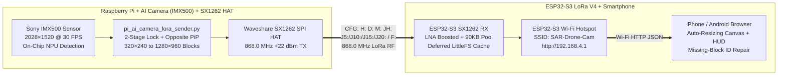
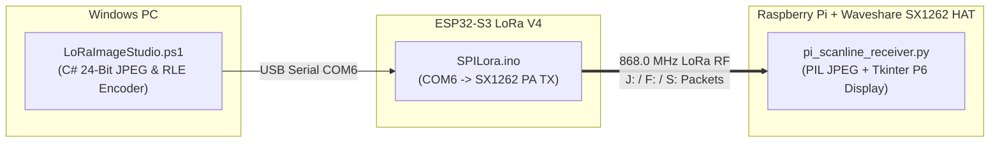

# SAR Drone 2028×1520 AI Camera & Multi-Resolution 24-Bit LoRa System — Complete Handoff Guide

> [!IMPORTANT]
> **Quick Portability Summary:**
> To move this entire project to another Windows PC, copy the single folder [`C:\Users\eyres\.gemini\antigravity\scratch\lora_image_studio`](file:///C:/Users/eyres/.gemini/antigravity/scratch/lora_image_studio) onto a USB drive or cloud folder. It contains **every file and document needed** for both operating modes:
> 1. **Autonomous SAR Drone AI Camera Mode (Pi $\rightarrow$ ESP32-S3 $\rightarrow$ Phone):** Raspberry Pi + Sony IMX500 AI Camera (`2028×1520 @ 30 FPS` on-sensor NPU) + Waveshare SX1262 SPI Transmitter sending live target-first picture blocks (`320×240` to `1280×960`), opposite-corner PiP zoom insets, GPS coordinates, and telemetry to the ESP32-S3 Phone Wi-Fi Web Server (`SSID: SAR-Drone-Cam`, `Pass: rescue123`, `http://192.168.4.1`).
> 2. **PC Ground Studio Mode (PC $\rightarrow$ ESP32-S3 $\rightarrow$ Pi Display):** Windows 24-Bit JPEG & Scanline Studio ([LoRaImageStudio.ps1](file:///C:/Users/eyres/.gemini/antigravity/scratch/lora_image_studio/LoRaImageStudio.ps1)) streaming over the ESP32-S3 (`SPILora.ino`) to the Raspberry Pi display receiver ([pi_scanline_receiver.py](file:///C:/Users/eyres/.gemini/antigravity/scratch/lora_image_studio/pi_scanline_receiver.py)).

---

## 1. Complete File Inventory & Exact Locations

### A. Primary Project Directory (Windows PC)
**Folder Path:** [`C:\Users\eyres\.gemini\antigravity\scratch\lora_image_studio`](file:///C:/Users/eyres/.gemini/antigravity/scratch/lora_image_studio)

| File / Subfolder | Exact Path | Role & Description |
| :--- | :--- | :--- |
| **[pi_ai_camera_lora_sender.py](file:///C:/Users/eyres/.gemini/antigravity/scratch/lora_image_studio/pi_ai_camera_lora_sender.py)** | `C:\Users\eyres\.gemini\antigravity\scratch\lora_image_studio\pi_ai_camera_lora_sender.py` | **[SAR Drone Mode — Pi Sender]** Runs on the Raspberry Pi with the **Raspberry Pi AI Camera (Sony IMX500)** and **Waveshare SX1262 SPI HAT**. Configures the IMX500 at `2028×1520 @ 30 FPS`, runs a dedicated background camera capture thread (25–30 FPS UI), loads `SSD MobileNet` / `EfficientDet` / `YOLOv8n` / `NanoDet` `.rpk` models onto the IMX500 NPU, implements the 2-Stage Search $\rightarrow$ Zoom Confirmation state machine, composes multi-resolution snapshots (`320×240`, `640×480`, `960×720`, `1280×960`) with Auto-Opposite PiP insets, and broadcasts `CFG:`, `H:`, `D:`, `M:`, `JH:`, `J5:`/`J10:`/`J15:`/`J20:`, and `F:` packets over LoRa at `+22 dBm`. |
| **[esp32_sx1262_phone_receiver.ino](file:///C:/Users/eyres/.gemini/antigravity/scratch/lora_image_studio/esp32_sx1262_phone_receiver/esp32_sx1262_phone_receiver.ino)** | `C:\Users\eyres\.gemini\antigravity\scratch\lora_image_studio\esp32_sx1262_phone_receiver\esp32_sx1262_phone_receiver.ino` | **[SAR Drone Mode — ESP32-S3 Phone Receiver]** Runs on the diymore / Heltec ESP32-S3 LoRa V4. Starts the `SAR-Drone-Cam` Wi-Fi AP first (zero startup `malloc`), receives `868.0 MHz` LoRa packets via `serviceLoRaRx()`, extracts hardware `RSSI (dBm)` and `SNR (dB)` before `readData()` clears IRQ flags, stores blocks in a 90 KB static pool (`tilePool`), caches to `LittleFS` when idle, and serves a responsive DJI/Auterion-style mobile web UI at `http://192.168.4.1` with `/api/tiles?ids=...` missing-block reconciliation. |
| **[LoRaImageStudio.ps1](file:///C:/Users/eyres/.gemini/antigravity/scratch/lora_image_studio/LoRaImageStudio.ps1)** | `C:\Users\eyres\.gemini\antigravity\scratch\lora_image_studio\LoRaImageStudio.ps1` | **[PC Studio Mode — Windows Sender GUI]** PowerShell + Embedded C#/.NET application. Connects to the ESP32-S3 over USB Serial (`COM6`), encodes `640×480` images into **True 24-Bit JPEG `64×16` Tiles (`J:`)**, **Full-Frame Progressive 24-Bit JPEG Chunks (`F:`)**, or **480p RLE Scanlines (`S:`)**, and simulates packet drops/noise. |
| **[Start_LoRa_Studio.bat](file:///C:/Users/eyres/.gemini/antigravity/scratch/lora_image_studio/Start_LoRa_Studio.bat)** | `C:\Users\eyres\.gemini\antigravity\scratch\lora_image_studio\Start_LoRa_Studio.bat` | **[PC Studio Launcher]** One-click launcher (`powershell.exe -NoProfile -ExecutionPolicy Bypass -File "%~dp0LoRaImageStudio.ps1"`). |
| **[pi_scanline_receiver.py](file:///C:/Users/eyres/.gemini/antigravity/scratch/lora_image_studio/pi_scanline_receiver.py)** | `C:\Users\eyres\.gemini\antigravity\scratch\lora_image_studio\pi_scanline_receiver.py` | **[PC Studio Mode — Pi Receiver]** Master copy of the Raspberry Pi display receiver script (`PIspiLora.py`). Listens for `J:`, `F:`, `S:`, `CMD:LEVEL:`, and `CMD:CLEAR` packets and renders them into a `640×480` `tkinter` window using native `P6` binary PPM. |
| **[esp32_sx1262_v4_transmitter.ino](file:///C:/Users/eyres/.gemini/antigravity/scratch/lora_image_studio/esp32_sx1262_v4_transmitter/esp32_sx1262_v4_transmitter.ino)** | `C:\Users\eyres\.gemini\antigravity\scratch\lora_image_studio\esp32_sx1262_v4_transmitter\esp32_sx1262_v4_transmitter.ino` | **[PC Studio Mode — ESP32-S3 USB-to-LoRa Transmitter]** Reads lines from `COM6` (`115200` baud) and transmits them over the internal `SX1262` SPI radio + onboard PA/FEM amplifier at `868.0 MHz`. |
| **[FileServer8080.ps1](file:///C:/Users/eyres/.gemini/antigravity/scratch/lora_image_studio/FileServer8080.ps1)** | `C:\Users\eyres\.gemini\antigravity\scratch\lora_image_studio\FileServer8080.ps1` | **[Wi-Fi File Transfer Utility]** Zero-privilege TCP HTTP server on port `8080` (`http://10.77.59.187:8080/`) so the Raspberry Pi can download `.py` scripts over Wi-Fi/eduroam via `curl` or `wget`. |
| **[Start_Demo.bat](file:///C:/Users/eyres/.gemini/antigravity/scratch/lora_image_studio/Start_Demo.bat)** | `C:\Users\eyres\.gemini\antigravity\scratch\lora_image_studio\Start_Demo.bat` | **[1-Click Hardware-Free Demo Launcher]** Root launcher that starts the complete simulated Drone Mission Control GUI and Ground Station Phone HUD without any physical hardware. |
| **[demo/](file:///C:/Users/eyres/.gemini/antigravity/scratch/lora_image_studio/demo)** | `C:\Users\eyres\.gemini\antigravity\scratch\lora_image_studio\demo\` | **[Hardware-Free Demo Suite]** Contains `run_demo.py`, `demo_drone_sender.py` (simulated AI camera & Mission Control), `demo_ground_receiver.py` (simulated ESP32-S3 web server), and `sample_sar_aerial.jpg`. |
| **[SAR_Drone_Project_Report.md](file:///C:/Users/eyres/.gemini/antigravity/scratch/lora_image_studio/SAR_Drone_Project_Report.md)** | `C:\Users\eyres\.gemini\antigravity\scratch\lora_image_studio\SAR_Drone_Project_Report.md` | Full engineering report detailing all features, architecture, and every bug fix made during development. |
| **[PROJECT_HANDOFF_GUIDE.md](file:///C:/Users/eyres/.gemini/antigravity/scratch/lora_image_studio/PROJECT_HANDOFF_GUIDE.md)** | `C:\Users\eyres\.gemini\antigravity\scratch\lora_image_studio\PROJECT_HANDOFF_GUIDE.md` | This complete technical handoff guide stored directly inside the project folder. |

### B. Active Arduino Sketchbook Copies (Windows PC)
| Sketch | Exact Path | Description |
| :--- | :--- | :--- |
| **[ESP32_Phone_LoRa_Receiver.ino](file:///C:/Users/eyres/OneDrive/Documents/Arduino/ESP32_Phone_LoRa_Receiver/ESP32_Phone_LoRa_Receiver.ino)** | `C:\Users\eyres\OneDrive\Documents\Arduino\ESP32_Phone_LoRa_Receiver\ESP32_Phone_LoRa_Receiver.ino` | Ready-to-open Arduino IDE sketch for **SAR Drone Mode** (ESP32-S3 LoRa Receiver + Phone Wi-Fi Web Server). |
| **[SPILora.ino](file:///C:/Users/eyres/OneDrive/Documents/Arduino/SPILora/SPILora.ino)** | `C:\Users\eyres\OneDrive\Documents\Arduino\SPILora\SPILora.ino` | Ready-to-open Arduino IDE sketch for **PC Studio Mode** (ESP32-S3 USB-to-LoRa Transmitter). |

### C. Raspberry Pi File Locations (On the Pi SD Card)
| File / Folder on Pi | Exact Path on Raspberry Pi | Role & Description |
| :--- | :--- | :--- |
| **`pi_ai_camera_lora_sender.py`** | `/home/rhys/Documents/SearchRescueDroneProject/pi_ai_camera_lora_sender.py` | Active **AI Camera Person Detector + LoRa Transmitter UI** script for Drone Mode. |
| **`broadcast_logs/`** | `/home/rhys/Documents/SearchRescueDroneProject/broadcast_logs/` | Local archive of every transmitted snapshot (`SAR_Capture_001.jpg`, etc.) and `broadcast_history.log`. |
| **`PIspiLora.py`** | `/home/rhys/Documents/SearchRescueDroneProject/PIspiLora.py` | Active **LoRa 480p Display Receiver** script for PC Studio Mode. |
| **Waveshare `LoRaRF` Driver** | `/home/rhys/sx126x_lorawan_hat_code/python/lora/LoRaRF/SX126x.py` | Waveshare's Python SPI driver library for the SX1262 LoRa Node HAT. |
| **Sony IMX500 AI Models** | `/usr/share/imx500-models/*.rpk` | Pre-compiled Sony IMX500 neural network firmware packages installed via `sudo apt install imx500-all`. |
| **Boot SPI Config** | `/boot/firmware/config.txt` *(or `/boot/config.txt`)* | Contains `dtparam=spi=on` and `dtoverlay=spi0-0cs,cs0_pin=21` so Linux `spidev0.0` maps to the Waveshare HAT's `GPIO 21` CS pin. |

---

## 2. Mode A (Primary): Autonomous SAR Drone AI Camera Mode (Pi $\rightarrow$ ESP32-S3 $\rightarrow$ Phone)



### Key Capabilities
1. **On-Sensor Neural Inference (`2028×1520 @ 30 FPS`):**
   - The Sony IMX500 runs `SSD MobileNet`, `EfficientDet`, `YOLOv8n`, or `NanoDet` directly on its integrated NPU.
   - A dedicated background thread (`camera_capture_thread()`) captures `2028×1520` frames and prepares strided NumPy slices so the Tkinter GUI runs smoothly at 25–30 FPS.
2. **2-Stage Search $\rightarrow$ Zoom Confirmation & Auto-Opposite PiP:**
   - Requires 3 frames $\ge$ *Wide Trigger %* to enter `ZOOM_CONFIRM`, followed by 3 zoomed frames $\ge$ *Confirm Lock %* to trigger an automatic transmission.
   - Places the zoomed target scope PiP inset in the corner **diagonally opposite** the detected person so the target is never covered.
3. **Multi-Resolution Target-First Picture Blocks (`320×240`, `640×480`, `960×720`, `1280×960`):**
   - Encodes `64×16` JPEG blocks with a 3-byte aligned shared header (`JH:`) and per-block blur guard ($\le 184$ Base64 chars), sorted radially outward from the detected person (`SCAN_TARGET`).
   - Prefixes every block packet with its column count (`J5:`, `J10:`, `J15:`, `J20:`) so the ESP32 and phone resize to the exact resolution immediately.
4. **Active Missing-Block Repair on Pass 2 (`/api/tiles?ids=...`):**
   - On every 500 ms poll, the phone requests both newly arrived blocks (`since=lastTileSeq`) and up to 25 specific missing block indices (`ids=...`) from the ESP32's RAM pool so Pass 2 rescans fill in any dropped blocks immediately.

---

## 3. Hardware-Free Git Demo Suite (Zero Hardware Required)

For users who clone this repository from GitHub and do not have the physical hardware (no Raspberry Pi, Sony IMX500 camera, or ESP32-S3 LoRa boards), a complete standalone demonstration suite is included in the `demo/` folder:

- **1-Click Launch:** Double-click `Start_Demo.bat` (or run `python demo/run_demo.py`).
- **Airborne Drone Simulator (`demo_drone_sender.py`):**
  - Tkinter GUI with the exact DJI Pilot 2 / Auterion dark-slate styling.
  - Generates realistic high-res aerial SAR terrain with lost subject detection.
  - Click anywhere on the Wide optical sensor to move the lost person.
  - Smooth tracking scope gimbal pans and zooms into the target.
  - Real 2-Stage Target Confirmation State Machine (`WIDE_SEARCH` $\rightarrow$ `ZOOM_CONFIRM` $\rightarrow$ `LOCKED`).
  - Auto-Opposite Corner PiP composition (never covers candidate).
  - True 64×16 24-bit JPEG block encoder with radial sorting (Target-First).
  - Simulated RF packet loss slider (0%–30%) and signal power slider (-45 to -125 dBm).
- **Ground Station & Mobile Web Server (`demo_ground_receiver.py`):**
  - Pure Python standard library HTTP server and virtual 868 MHz LoRa UDP receiver.
  - Hosts the complete responsive mobile web dashboard on `http://localhost:8088/` (and local LAN IP for smartphones!).
  - Live 40-sample RSSI graph, 5-bar signal meter, dynamic multi-resolution canvas (`320×240` to `1280×960`).
  - Active missing-block reconciliation (`/api/tiles?ids=...`) demonstrating Pass 2 rescan repairs!
  - Export Photo (JPG), Full HTML Incident Report, and Signal CSV.

---

## 4. Mode B: PC Ground Studio Mode (PC → ESP32-S3 → Pi Display)



* Uses [LoRaImageStudio.ps1](file:///C:/Users/eyres/.gemini/antigravity/scratch/lora_image_studio/LoRaImageStudio.ps1) on Windows, [SPILora.ino](file:///C:/Users/eyres/OneDrive/Documents/Arduino/SPILora/SPILora.ino) on the ESP32-S3, and [pi_scanline_receiver.py](file:///C:/Users/eyres/.gemini/antigravity/scratch/lora_image_studio/pi_scanline_receiver.py) (`PIspiLora.py`) on the Raspberry Pi.

---

## 4. Hardware Pinouts & Configuration Reference

### A. diymore / Heltec ESP32-S3 LoRa V4 (`SX1262` SPI)
| Signal | ESP32-S3 GPIO | Role in Transmitter Sketch (`SPILora.ino`) | Role in Phone Receiver Sketch (`ESP32_Phone_LoRa_Receiver.ino`) |
| :--- | :---: | :--- | :--- |
| `LORA_NSS` (CS) | `GPIO 8` | SX1262 SPI Chip Select | SX1262 SPI Chip Select |
| `LORA_SCK` | `GPIO 9` | SX1262 SPI Clock | SX1262 SPI Clock |
| `LORA_MOSI` | `GPIO 10` | SX1262 SPI MOSI | SX1262 SPI MOSI |
| `LORA_MISO` | `GPIO 11` | SX1262 SPI MISO | SX1262 SPI MISO |
| `LORA_RST` | `GPIO 12` | SX1262 Hardware Reset | SX1262 Hardware Reset |
| `LORA_BUSY` | `GPIO 13` | SX1262 Busy Status Input | SX1262 Busy Status Input |
| `LORA_DIO1` | `GPIO 14` | SX1262 DIO1 | SX1262 Packet Received Interrupt (`onLoRaRx`) |
| `FEM_VFEM` | `GPIO 7` | `HIGH` (Enables FEM LDO power) | `HIGH` (Enables FEM LDO power) |
| `FEM_CSD` | `GPIO 2` | `HIGH` (Enables FEM chip) | `HIGH` (Enables FEM chip) |
| `FEM_CPS_V42` | `GPIO 46` | `HIGH` (PA Transmit path active) | `LOW` (LNA Receive path active) |
| `FEM_CPS_V43` | `GPIO 5` | `HIGH` (PA Transmit path active) | `LOW` (LNA Receive path active) |
| `LED_PIN` | `GPIO 35` | Pulses `HIGH` on TX | Pulses `HIGH` on RX |

### B. Raspberry Pi Waveshare SX1262 868M LoRa Node SPI HAT
Initialized via `LoRa.begin(0, 0, 18, 20, -1, 6, -1)`:
* **SPI Bus / CS:** `bus = 0, cs = 0` mapped to `GPIO 21` via `/boot/firmware/config.txt` (`dtoverlay=spi0-0cs,cs0_pin=21`)
* **Reset (`RST`):** `GPIO 18`
* **Busy (`BUSY`):** `GPIO 20`
* **TX Enable (`TXEN`):** `GPIO 6` + `LoRa.setDio2RfSwitch()`
* **Transmit Power (in Drone Sender mode):** `LoRa.setTxPower(22, LoRa.TX_POWER_SX1262)` (`+22 dBm`)
* **Sync Word:** `0x1424` (matches `0x12` in RadioLib on ESP32-S3)

---

## 5. Wire Protocol & Packet Formats (Complete Specification)

| Prefix | Format | Used In | Description |
| :---: | :--- | :--- | :--- |
| **`CFG:`** | `CFG:<level>:<txMode>:<aiModel>:<confirmThresh>:<txW>:<txH>` | Drone Mode | **Instant Over-The-Air Config Sync.** Sent 3–4× whenever a mode, model, resolution, or level button is clicked on the Pi. |
| **`H:`** | `H:<seq>:<zoomState>:<liveConf>:<txMode>:<aiModel>:<txW>:<txH>:<gpsStr>` | Drone Mode | **2.5-Second Heartbeat Beacon.** Sent while idle to update live confidence, drone state, resolution, GPS, and RSSI/SNR history. |
| **`D:`** | `D:<captureId>:<maxConfPct>:<personCount>:<totalUnits>:<jpegQ>:<txW>:<txH>` | Drone Mode | **AI Person Detection Alert & Resolution Header.** Sent 3× before Pass 1, before Pass 2+, and every 35 blocks mid-stream. |
| **`M:`** | `M:<captureId>:<modeCode>:<timeStr>:<gpsStr>:<noteStr>` | Drone Mode | **Broadcast Metadata Packet.** Carries capture timestamp, mode code, GPS fix, and unit/sector note. |
| **`JH:`** | `JH:<idx>:<tot>:<b64>` | Drone Mode | **Common 64×16 JPEG Header Chunk.** 3-byte aligned common JPEG header shared across all blocks in a capture. |
| **`J<cols>:`** | `J<tCols>:<col>:<row>:<chk2>:<scanB64>` *(e.g. `J5:`, `J10:`, `J15:`, `J20:`)* | Drone Mode | **Multi-Resolution 64×16 Picture Block.** Self-identifies resolution (`5`=`320×240`, `10`=`640×480`, `15`=`960×720`, `20`=`1280×960`) and carries 12-bit CRC `chk2` + Base64 entropy scan body. |
| **`F:`** | `F:<chunkIdx>:<totalChunks>:<chk2>:<b64Chunk>` | Both Modes | **Full-Frame 24-Bit Progressive JPEG Chunk.** |
| **`J:`** *(Studio)* | `J:<tx>:<ty>:<spanW>:<spanH>:<qIdx>:<chk2>:<b64EntropyBody>` | PC Studio Mode | **Headerless 24-Bit JPEG `64×16` Tile** using precomputed `.NET` DQT tables `0..7`. |
| **`S:`** | `S:<y>:<spanH>:<chk2>:<encoded3CharSpans>` | PC Studio Mode | **1D Smooth RLE Scanline** (`12-bit RGB444` with linear span interpolation). |
| **`CMD:LEVEL:`** | `CMD:LEVEL:<0..7>` | Both Modes | Over-the-air speed change command sent 5× before retuning both radios to level `0..7`. |
| **`CMD:CLEAR`** | `CMD:CLEAR` | Both Modes | Clears receiver RAM pool, LittleFS image cache, and phone canvas. |

---

## 6. How to Transfer Files & Run the System

### Step 1: Start the Local HTTP File Server on Windows (`FileServer8080.ps1`)
```powershell
powershell.exe -NoProfile -ExecutionPolicy Bypass -File "C:\Users\eyres\.gemini\antigravity\scratch\lora_image_studio\FileServer8080.ps1"
```
*(Current Windows PC IPv4 address on eduroam: **`10.77.59.187`**, port **`8080`**).*

### Step 2: Flash the ESP32-S3 Phone Receiver
1. Open [`ESP32_Phone_LoRa_Receiver.ino`](file:///C:/Users/eyres/OneDrive/Documents/Arduino/ESP32_Phone_LoRa_Receiver/ESP32_Phone_LoRa_Receiver.ino) in Arduino IDE (`ESP32S3 Dev Module`, `USB CDC On Boot: Enabled`) and click **Upload**.
2. Connect your phone to Wi-Fi SSID **`SAR-Drone-Cam`** (password: **`rescue123`**) and open **`http://192.168.4.1`**.

### Step 3: Pull & Launch on the Raspberry Pi
```bash
cd ~/Documents/SearchRescueDroneProject
curl -O http://10.77.59.187:8080/pi_ai_camera_lora_sender.py
python3 pi_ai_camera_lora_sender.py
```
