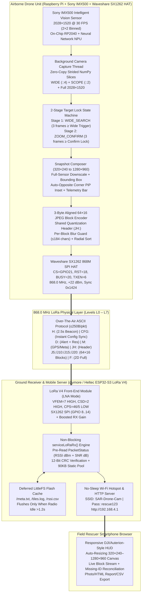

# Autonomous Search & Rescue (SAR) Drone AI Vision & 868 MHz LoRa Image Transmission System

[](LICENSE)
[](https://www.python.org/)
[](https://heltec.org/)
[](https://www.raspberrypi.com/)
[](https://www.raspberrypi.com/products/ai-camera/)
[](https://www.semtech.com/)

A complete, self-contained **Search and Rescue (SAR) Optical AI Detection and Long-Range LoRa Image Broadcast System**. Designed for wilderness search, avalanche rescue, and post-disaster reconnaissance where cellular coverage, satellite uplinks, and high-bandwidth Wi-Fi video links are unavailable or out of range.

---

## ⚡ Quick Start: Hardware-Free Demo

**No hardware? No problem!** You can run the entire system on any PC, Mac, or Linux computer using the built-in simulator:

```bash
# 1. Install Pillow (only dependency required!)
pip install pillow

# 2. Run the 1-click launcher (or double-click Start_Demo.bat on Windows)
python demo/run_demo.py
```

This single command:
1. Spawns the **Virtual Ground Station & Mobile Web Server** (`demo_ground_receiver.py`).
2. Opens your browser to the **Ground Rescuer Mobile HUD** (`http://localhost:8088/`).
3. Launches the **Airborne Drone AI Mission Control GUI** (`demo_drone_sender.py`) with simulated 30 FPS optical tracking, 2-stage lock FSM, auto-opposite PiP composition, and real-time block streaming!
4. *(Optional)* Pull out your smartphone on the same Wi-Fi, open `http://<YOUR-PC-IP>:8088/`, and watch blocks materialize live on your phone screen!

See [`demo/README.md`](demo/README.md) for full demo instructions and packet-loss test scenarios.

---

## 🛰️ System Architecture



---

## 🌟 Key Technical Features

1. **Sony IMX500 On-Sensor Neural Network Inference:**
   - Runs neural object detection (`SSD MobileNetV2`, `EfficientDet-Lite0`, `YOLOv8n`, `NanoDet`) directly inside the camera's stacked silicon at the sensor's native **2×2 binned `2028×1520 @ 30 FPS`** mode.
   - Pi CPU load remains virtually zero because all CNN compute occurs on the IMX500's integrated hardware accelerator before frames reach Linux memory.
2. **2-Stage Target Confirmation State Machine:**
   - Eliminates single-frame false alarms from triggering 30-second LoRa transmissions:
     - **Stage 1 (`WIDE_SEARCH`):** Requires target detection $\ge 38\%$ for 3 consecutive frames.
     - **Stage 2 (`ZOOM_CONFIRM`):** Digital gimbal swings and zooms ($2.5\times$) onto the candidate; requires 3 consecutive frames $\ge 58\%$ before firing an automatic broadcast.
3. **Auto-Opposite Corner Picture-in-Picture (PiP):**
   - Automatically computes the detected person's quadrant (`cx, cy`) in the `2028×1520` sensor frame.
   - Pastes the zoomed scope inset into the **diagonally opposite corner**, guaranteeing the target is never obscured by the zoom box!
4. **Target-First 64×16 Picture Block Encoding (`SCAN_TARGET`):**
   - Slices snapshots into 24-bit JPEG blocks aligned at exact 3-byte boundaries so Base64 concatenates with zero padding.
   - Sorts blocks radially outward from the detected person: the subject materializes on the rescuer's phone within the first 1–2 seconds, while the surrounding terrain fills outward.
5. **Pass 2 Rescan Repair (`/api/tiles?ids=...`):**
   - If severe RF interference drops packets during Pass 1, the receiver actively queries missing grid IDs during Pass 2, repairing every dropped hole until the image is 100% complete.
6. **Zero-`malloc` ESP32-S3 No-Sleep Wi-Fi AP (`SAR-Drone-Cam`):**
   - Built to operate stably even when `PSRAM=disabled` in Arduino IDE.
   - Uses a compact **90 KB static memory pool (`tilePool[92160]`)** and starts `WiFi.softAP()` with `WiFi.setSleep(false)` and `WIFI_POWER_19_5dBm` with $>190\text{ KB}$ heap headroom.
7. **Dynamic Multi-Resolution Grid:**
   - Supports 4 standardized SAR aspect ratios: `320×240` (75 blocks), `640×480` (300 blocks), `960×720` (675 blocks), and `1280×960` (1200 blocks).
   - Changing resolution cancels any in-progress transmission (`tx_session_id`) and immediately resizes the phone viewport canvas.
8. **Field Dossier & Signal Export:**
   - One-tap **Save Photo (JPG)**, **Export Report (HTML)** (complete incident dossier with embedded images, coordinates, and signal tables), and **Signal CSV** log directly from the smartphone browser.

---

## 📦 Repository Structure

```text
├── README.md                      # This main GitHub documentation
├── LICENSE                        # MIT Open Source License
├── .gitignore                     # Git exclusion rules
├── Start_Demo.bat                 # 1-Click launcher for the hardware-free demo
├── Start_LoRa_Studio.bat          # 1-Click launcher for the PC Studio testbench
├── PROJECT_HANDOFF_GUIDE.md       # Complete deployment, wiring, and operating guide
├── SAR_Drone_Project_Report.md    # Comprehensive engineering report & bug-fix history
├── SAR_Drone_Project_Report.docx  # Formatted Word document version of report
├── FileServer8080.ps1             # Local zero-privilege Wi-Fi file server
│
├── pi_ai_camera_lora_sender.py    # Main Airborne SAR Drone Transmitter (Raspberry Pi)
├── pi_scanline_receiver.py        # PC Studio Mode — Pi display receiver (PIspiLora.py)
├── LoRaImageStudio.ps1            # PC Studio Mode — Windows WPF ground studio & link tester
│
├── esp32_sx1262_phone_receiver/   # Ground Station ESP32-S3 Firmware
│   └── esp32_sx1262_phone_receiver.ino
│
├── esp32_sx1262_v4_transmitter/   # PC Studio Mode — ESP32 USB-to-LoRa Bridge Firmware
│   └── esp32_sx1262_v4_transmitter.ino
│
└── demo/                          # Full Hardware-Free Demo Suite
    ├── run_demo.py                # Python master demo launcher
    ├── Start_Demo.bat             # Batch launcher for demo folder
    ├── demo_drone_sender.py       # Simulated Drone Mission Control GUI (Tkinter + PIL)
    ├── demo_ground_receiver.py    # Simulated ESP32-S3 Web Server & LoRa UDP receiver
    ├── generate_sample_scene.py   # Procedural SAR aerial terrain generator
    ├── sample_sar_aerial.jpg      # 2028x1520 high-res synthetic SAR test scene
    └── README.md                  # Demo documentation & guide
```

---

## 🔌 Hardware Pinouts & RF Configuration

### 1. diymore / Heltec ESP32-S3 LoRa V4 (`SX1262` + External PA/LNA FEM)

| Signal | ESP32-S3 GPIO | Drone Mode (`esp32_sx1262_phone_receiver.ino`) | Notes |
| :--- | :---: | :--- | :--- |
| `LORA_NSS` (CS) | `GPIO 8` | SPI Chip Select | `HSPI` instance |
| `LORA_SCK` | `GPIO 9` | SPI Clock | |
| `LORA_MOSI` | `GPIO 10` | SPI MOSI | |
| `LORA_MISO` | `GPIO 11` | SPI MISO | |
| `LORA_RST` | `GPIO 12` | Hardware Reset | |
| `LORA_BUSY` | `GPIO 13` | Radio Busy Input | |
| `LORA_DIO1` | `GPIO 14` | RX Done IRQ | `radio.setDio1Action(onLoRaRx)` |
| `FEM_VFEM` | `GPIO 7` | `HIGH` | Power to external FEM LDO |
| `FEM_CSD` | `GPIO 2` | `HIGH` | FEM Enable |
| `FEM_CPS_V42` | `GPIO 46` | **`LOW` (LNA Mode)** | Receive path enable (V4.2) |
| `FEM_CPS_V43` | `GPIO 5` | **`LOW` (LNA Mode)** | Receive path enable (V4.3) |
| `LED_PIN` | `GPIO 35` | Pulses on packet RX | White onboard status LED |

### 2. Raspberry Pi + Waveshare SX1262 868M LoRa Node SPI HAT

| Signal | Raspberry Pi Pin | Driver Parameter / Notes |
| :--- | :---: | :--- |
| `SPI CS` | `GPIO 21` (Pin 40) | Linux `spidev0.0` bound to GPIO 21 via `dtoverlay=spi0-0cs,cs0_pin=21` in `/boot/firmware/config.txt` |
| `SPI SCK` | `GPIO 11` (Pin 23) | Hardware SPI0 |
| `SPI MOSI` | `GPIO 10` (Pin 19) | Hardware SPI0 |
| `SPI MISO` | `GPIO 9` (Pin 21) | Hardware SPI0 |
| `RST` | `GPIO 18` (Pin 12) | Hardware Reset |
| `BUSY` | `GPIO 20` (Pin 38) | Busy Status |
| `TXEN` | `GPIO 6` (Pin 31) | Transmit Power Switch (`+22 dBm`) |

---

## 📡 Matched 8-Level LoRa Modulation Presets

Both the airborne transmitter and ground receiver share a matched 8-level preset table:

| Level | Spreading Factor | Bandwidth | Coding Rate | Gap | Typical Application |
| :---: | :---: | :---: | :---: | :---: | :--- |
| **L0** | `SF12` | `125 kHz` | `4/5` | `1450 ms` | Extreme range / heavy foliage / non-line-of-sight |
| **L1** | `SF11` | `125 kHz` | `4/5` | `780 ms` | Very long range wilderness |
| **L2** | `SF10` | `125 kHz` | `4/5` | `410 ms` | Long range mountain operations |
| **L3** | `SF9` | `250 kHz` | `4/5` | `175 ms` | Medium range |
| **L4** | `SF8` | `250 kHz` | `4/5` | `110 ms` | Medium-fast |
| **L5** | **`SF7`** | **`250 kHz`** | **`4/5`** | **`75 ms`** | **Standard fast SAR link (Default)** |
| **L6** | `SF7` | `500 kHz` | `4/5` | `55 ms` | Turbo speed (line-of-sight) |
| **L7** | `SF6` | `500 kHz` | `4/5` | `45 ms` | Maximum speed (close range) |

---

## 📜 Over-The-Air Wire Protocol Specification

All packets are printable ASCII lines ($\le 250$ bytes) protected by both hardware 16-bit CRC and an application-level 12-bit polynomial CRC (`chk2`, polynomial `0x1021`, seed `0xACE1`):

| Packet | Format | Purpose |
| :--- | :--- | :--- |
| **`CFG:`** | `CFG:<level>:<mode>:<model>:<confirmThresh>:<w>:<h>` | Instant configuration sync sent when any button is clicked |
| **`H:`** | `H:<seq>:<state>:<liveConf>:<mode>:<model>:<w>:<h>:<gps>` | 2.5s beacon keeping link green and signal charts updated |
| **`D:`** | `D:<id>:<maxConf>:<personCount>:<totalUnits>:<jpegQ>:<w>:<h>` | Target alert & resolution header (sent before & mid-stream) |
| **`M:`** | `M:<id>:<mode>:<time>:<gps>:<note>` | Capture timestamp, GPS coordinates, and sector note |
| **`JH:`** | `JH:<partIdx>:<totalParts>:<b64HeaderChunk>` | Shared 64×16 JPEG header (split at 3-byte multiple) |
| **`J<cols>:`** | `J<cols>:<col>:<row>:<chk2>:<scanB64>` | Single 64×16 JPEG block (prefix encodes `cols` e.g. `J10:`) |
| **`F:`** | `F:<chunkIdx>:<totalChunks>:<chk2>:<b64Chunk>` | 2D Progressive JPEG slice |
| **`CMD:LEVEL:`** | `CMD:LEVEL:<0..7>` | Over-the-air link speed retuning command |
| **`CMD:CLEAR`** | `CMD:CLEAR` | Remote screen and cache clear command |

---

## 🛠️ Step-by-Step Hardware Deployment

### 1. Flash the ESP32-S3 Ground Station
- Open Arduino IDE $\rightarrow$ File $\rightarrow$ Open $\rightarrow$ [`esp32_sx1262_phone_receiver/esp32_sx1262_phone_receiver.ino`](esp32_sx1262_phone_receiver/esp32_sx1262_phone_receiver.ino).
- Install **RadioLib** (v7.1.2 or v8.0.0).
- Select Board: **ESP32S3 Dev Module** (or Heltec Wireless Stick Lite V3).
- Board Settings: `USB Mode: Hardware CDC and JTAG`, `USB CDC On Boot: Disabled` (or Enabled), `Flash Size: 16MB` (or 4MB), `Partition Scheme: Default 4MB with spiffs` (or 16MB), `PSRAM: Disabled` (or QSPI/OPI).
- Click **Upload**.

### 2. Connect Your Phone
- On your smartphone, connect to the Wi-Fi hotspot:
  - **SSID:** `SAR-Drone-Cam`
  - **Password:** `rescue123`
- Open any mobile web browser and navigate to:
  ```text
  http://192.168.4.1/
  ```

### 3. Run the Airborne Drone System (Raspberry Pi)
- Connect the Sony IMX500 AI Camera and Waveshare SX1262 SPI HAT.
- Ensure SPI overlay is in `/boot/firmware/config.txt`:
  ```text
  dtparam=spi=on
  dtoverlay=spi0-0cs,cs0_pin=21
  ```
- Run the mission control software:
  ```bash
  python3 pi_ai_camera_lora_sender.py
  ```

---

## 📄 License & Attribution

This project is released under the **MIT License**. See [LICENSE](LICENSE) for details.

Developed for autonomous optical Search and Rescue operations, disaster response, and long-range emergency telemetry.
