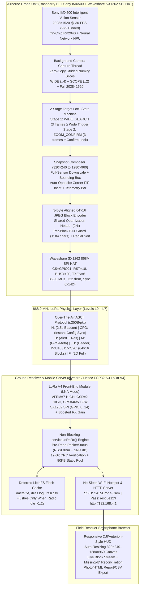

# Autonomous Search & Rescue (SAR) Drone AI Camera & 868 MHz LoRa Image Transmission System — Complete Engineering Report

*Last Updated: 12 November 2026*

---

## 1. Executive Summary & Project Purpose

This project implements a complete, self-contained **Search and Rescue (SAR) Optical AI Detection and Long-Range LoRa Image Broadcast System**. It is designed for disaster-response and wilderness search scenarios where cellular networks, satellite internet, and high-bandwidth Wi-Fi video links are unavailable or out of range.

The system operates in two complementary modes built on the same hardware pair (**Raspberry Pi + Waveshare SX1262 868M SPI HAT** and **diymore / Heltec ESP32-S3 LoRa V4 SX1262**):

1. **Primary Mode — Autonomous SAR Drone AI Camera Mode (Pi $\rightarrow$ ESP32-S3 $\rightarrow$ Phone):**
   - The airborne **Raspberry Pi** uses the **Raspberry Pi AI Camera (Sony IMX500)** running on-sensor neural network object detection (`SSD MobileNetV2`, `EfficientDet-Lite0`, `YOLOv8n`, `NanoDet`) at the sensor's native **2×2 binned `2028×1520 @ 30 FPS`** mode.
   - A **2-Stage Search $\rightarrow$ Zoom Confirmation State Machine** eliminates false triggers: when a person is spotted in the wide view, a smooth digital gimbal tracking scope zooms in on the candidate and confirms the lock over multiple frames before triggering a broadcast.
   - Upon lock (or manual trigger), the Pi composes an annotated multi-resolution snapshot (`320×240`, `640×480`, `960×720`, or `1280×960`) directly from the `2028×1520` sensor frame, places a **Picture-in-Picture (PiP) zoom inset in the corner diagonally opposite the detected person** (so the target is never obscured), and transmits the image over `868.0 MHz` LoRa at `+22 dBm`.
   - In **Target-First Picture Block Mode (`SCAN_TARGET`)**, the image is encoded into `64×16` 24-bit JPEG blocks sorted radially outward from the detected person, so the person materializes on the ground rescuer's phone within the first 1–2 seconds of transmission, while the surrounding terrain fills in outward.
   - On the ground, the **ESP32-S3 LoRa V4** receives the packets via its internal `SX1262` SPI radio + external low-noise amplifier (LNA), caches blocks in RAM and onboard `LittleFS` flash, and hosts a standalone **No-Sleep Wi-Fi Hotspot (`SSID: SAR-Drone-Cam`, `Pass: rescue123`, `http://192.168.4.1`)** where any smartphone browser renders the live image, GPS coordinates, target confidence, and RF signal history (`RSSI dBm` & `SNR dB`).
2. **Secondary Mode — PC Ground Studio & Link Testbench Mode (PC $\rightarrow$ ESP32-S3 $\rightarrow$ Pi Display):**
   - A Windows C#/.NET + PowerShell studio application ([LoRaImageStudio.ps1](file:///C:/Users/eyres/.gemini/antigravity/scratch/lora_image_studio/LoRaImageStudio.ps1)) that encodes test images into **True 24-Bit `64×16` JPEG Tiles (`J:`)**, **Full-Frame Progressive 24-Bit JPEGs (`F:`)**, or **1D Smooth-Interpolated RLE Scanlines (`S:`)**, simulates RF packet loss/corruption, and transmits them via the ESP32-S3 (`COM6` USB Serial $\rightarrow$ `SX1262` PA TX) to the Raspberry Pi display receiver ([pi_scanline_receiver.py](file:///C:/Users/eyres/.gemini/antigravity/scratch/lora_image_studio/pi_scanline_receiver.py)).

---

## 2. System Architecture & End-to-End Data Flow



---

## 3. Complete File Inventory & Locations

### A. Master Project Directory (Windows PC)
**Directory:** [`C:\Users\eyres\.gemini\antigravity\scratch\lora_image_studio`](file:///C:/Users/eyres/.gemini/antigravity/scratch/lora_image_studio)

| File | Exact Path | Role & Detailed Description |
| :--- | :--- | :--- |
| **[pi_ai_camera_lora_sender.py](file:///C:/Users/eyres/.gemini/antigravity/scratch/lora_image_studio/pi_ai_camera_lora_sender.py)** | [`C:\Users\eyres\.gemini\antigravity\scratch\lora_image_studio\pi_ai_camera_lora_sender.py`](file:///C:/Users/eyres/.gemini/antigravity/scratch/lora_image_studio/pi_ai_camera_lora_sender.py) | **Airborne Drone AI Camera & LoRa Transmitter (`1,306` lines).** Runs on the Raspberry Pi. Interfaces with the Sony IMX500 AI Camera (`2028×1520 @ 30 FPS`), runs the background capture thread, 2-stage target confirmation state machine, smooth digital gimbal scope, opposite-corner PiP composer, multi-resolution `64×16` JPEG block encoder (`320×240` to `1280×960`), optional USB/UART NMEA GPS reader, local capture logger, and Waveshare SX1262 SPI transmitter. |
| **[esp32_sx1262_phone_receiver.ino](file:///C:/Users/eyres/.gemini/antigravity/scratch/lora_image_studio/esp32_sx1262_phone_receiver/esp32_sx1262_phone_receiver.ino)** | [`C:\Users\eyres\.gemini\antigravity\scratch\lora_image_studio\esp32_sx1262_phone_receiver\esp32_sx1262_phone_receiver.ino`](file:///C:/Users/eyres/.gemini/antigravity/scratch/lora_image_studio/esp32_sx1262_phone_receiver/esp32_sx1262_phone_receiver.ino) | **Ground ESP32-S3 LoRa Receiver & Phone Wi-Fi Web Server (`1,722` lines).** Runs on the diymore / Heltec ESP32-S3 LoRa V4. Configures the onboard PA/LNA FEM for high-sensitivity LNA receive, decodes all LoRa packet types (`CFG:`, `H:`, `D:`, `M:`, `JH:`, `J5:`/`J10:`/`J15:`/`J20:`, `F:`, `CMD:LEVEL:`, `CMD:CLEAR`), stores blocks in a zero-`malloc` 90 KB static pool (`tilePool`), caches to `LittleFS` when idle, and serves the mobile web UI (`http://192.168.4.1`). |
| **[LoRaImageStudio.ps1](file:///C:/Users/eyres/.gemini/antigravity/scratch/lora_image_studio/LoRaImageStudio.ps1)** | [`C:\Users\eyres\.gemini\antigravity\scratch\lora_image_studio\LoRaImageStudio.ps1`](file:///C:/Users/eyres/.gemini/antigravity/scratch/lora_image_studio/LoRaImageStudio.ps1) | **PC Ground Studio & Link Testbench GUI (`1,119` lines).** PowerShell + embedded C# (`SmoothScanlineEncoder`) desktop studio for Windows. Connects to the ESP32-S3 over USB Serial (`COM6`), encodes `640×480` images into headerless `64×16` 24-bit JPEG tiles (`J:`), full-frame progressive JPEG chunks (`F:`), or 1D smooth RLE scanlines (`S:`), and provides packet drop/corruption simulation. |
| **[Start_LoRa_Studio.bat](file:///C:/Users/eyres/.gemini/antigravity/scratch/lora_image_studio/Start_LoRa_Studio.bat)** | [`C:\Users\eyres\.gemini\antigravity\scratch\lora_image_studio\Start_LoRa_Studio.bat`](file:///C:/Users/eyres/.gemini/antigravity/scratch/lora_image_studio/Start_LoRa_Studio.bat) | **One-Click Studio Launcher.** Launches `LoRaImageStudio.ps1` with `-NoProfile -ExecutionPolicy Bypass` using relative path `%~dp0`. |
| **[pi_scanline_receiver.py](file:///C:/Users/eyres/.gemini/antigravity/scratch/lora_image_studio/pi_scanline_receiver.py)** | [`C:\Users\eyres\.gemini\antigravity\scratch\lora_image_studio\pi_scanline_receiver.py`](file:///C:/Users/eyres/.gemini/antigravity/scratch/lora_image_studio/pi_scanline_receiver.py) | **PC Studio Mode — Raspberry Pi Display Receiver (`444` lines).** Receives `J:` (headerless 64×16 JPEG tiles with 8 precomputed `.NET` DQT tables `Q85..Q15`), `F:` (progressive full-frame JPEG), and `S:` (1D smooth RLE scanlines) over the Waveshare SX1262 SPI HAT and renders them in a `640×480` Tkinter window via binary `P6` PPM. |
| **[esp32_sx1262_v4_transmitter.ino](file:///C:/Users/eyres/.gemini/antigravity/scratch/lora_image_studio/esp32_sx1262_v4_transmitter/esp32_sx1262_v4_transmitter.ino)** | [`C:\Users\eyres\.gemini\antigravity\scratch\lora_image_studio\esp32_sx1262_v4_transmitter\esp32_sx1262_v4_transmitter.ino`](file:///C:/Users/eyres/.gemini/antigravity/scratch/lora_image_studio/esp32_sx1262_v4_transmitter/esp32_sx1262_v4_transmitter.ino) | **PC Studio Mode — ESP32-S3 USB-to-LoRa Bridge (`135` lines).** Reads ASCII packets from `COM6` (`115200` baud) and transmits them via the internal `SX1262` SPI radio with the V4's onboard Power Amplifier enabled (`FEM_CPS_V42=HIGH`, `FEM_CPS_V43=HIGH`). |
| **[FileServer8080.ps1](file:///C:/Users/eyres/.gemini/antigravity/scratch/lora_image_studio/FileServer8080.ps1)** | [`C:\Users\eyres\.gemini\antigravity\scratch\lora_image_studio\FileServer8080.ps1`](file:///C:/Users/eyres/.gemini/antigravity/scratch/lora_image_studio/FileServer8080.ps1) | **Zero-Privilege Local HTTP File Server (`88` lines).** Uses `System.Net.Sockets.TcpListener` on port `8080` so the Raspberry Pi can download updated Python scripts over Wi-Fi/eduroam (`curl -O http://10.77.59.187:8080/pi_ai_camera_lora_sender.py`) without needing Administrator rights. |
| **[PROJECT_HANDOFF_GUIDE.md](file:///C:/Users/eyres/.gemini/antigravity/scratch/lora_image_studio/PROJECT_HANDOFF_GUIDE.md)** | [`C:\Users\eyres\.gemini\antigravity\scratch\lora_image_studio\PROJECT_HANDOFF_GUIDE.md`](file:///C:/Users/eyres/.gemini/antigravity/scratch/lora_image_studio/PROJECT_HANDOFF_GUIDE.md) | Complete portability, wiring, and step-by-step setup guide. |
| **[SAR_Drone_Project_Report.md](file:///C:/Users/eyres/.gemini/antigravity/scratch/lora_image_studio/SAR_Drone_Project_Report.md)** | [`C:\Users\eyres\.gemini\antigravity\scratch\lora_image_studio\SAR_Drone_Project_Report.md`](file:///C:/Users/eyres/.gemini/antigravity/scratch/lora_image_studio/SAR_Drone_Project_Report.md) | This comprehensive engineering report. |

### B. Synced Arduino IDE Sketchbook Copies (Windows PC)
| Sketch | Exact Path | Purpose |
| :--- | :--- | :--- |
| **[ESP32_Phone_LoRa_Receiver.ino](file:///C:/Users/eyres/OneDrive/Documents/Arduino/ESP32_Phone_LoRa_Receiver/ESP32_Phone_LoRa_Receiver.ino)** | [`C:\Users\eyres\OneDrive\Documents\Arduino\ESP32_Phone_LoRa_Receiver\ESP32_Phone_LoRa_Receiver.ino`](file:///C:/Users/eyres/OneDrive/Documents/Arduino/ESP32_Phone_LoRa_Receiver/ESP32_Phone_LoRa_Receiver.ino) | Active Arduino IDE sketch for **SAR Drone Mode** (ESP32-S3 Phone Receiver). Always kept 100% synced with `esp32_sx1262_phone_receiver.ino`. |
| **[SPILora.ino](file:///C:/Users/eyres/OneDrive/Documents/Arduino/SPILora/SPILora.ino)** | [`C:\Users\eyres\OneDrive\Documents\Arduino\SPILora\SPILora.ino`](file:///C:/Users/eyres/OneDrive/Documents/Arduino/SPILora/SPILora.ino) | Active Arduino IDE sketch for **PC Studio Mode** (ESP32-S3 USB-to-LoRa Transmitter). |

### C. Raspberry Pi File Locations (`/home/rhys/...`)
| Path on Raspberry Pi | Description |
| :--- | :--- |
| `/home/rhys/Documents/SearchRescueDroneProject/pi_ai_camera_lora_sender.py` | Main SAR Drone AI Camera + LoRa Transmitter script. |
| `/home/rhys/Documents/SearchRescueDroneProject/broadcast_logs/` | Auto-created folder storing every transmitted snapshot (`SAR_Capture_001.jpg`, etc.) and `broadcast_history.log`. |
| `/home/rhys/Documents/SearchRescueDroneProject/PIspiLora.py` | Display receiver script for PC Studio Mode (`pi_scanline_receiver.py`). |
| `/home/rhys/sx126x_lorawan_hat_code/python/lora/LoRaRF/SX126x.py` | Waveshare's Python SPI driver for the SX1262 HAT. |
| `/usr/share/imx500-models/*.rpk` | Pre-compiled Sony IMX500 neural network firmware packages (`imx500_network_ssd_mobilenetv2_fpnlite_320x320_pp.rpk`, `imx500_network_efficientdet_lite0_pp.rpk`, `imx500_network_yolov8n_pp.rpk`, `imx500_network_nanodet_plus_416x416_pp.rpk`). |
| `/boot/firmware/config.txt` | Contains `dtparam=spi=on` and `dtoverlay=spi0-0cs,cs0_pin=21` to bind Linux `spidev0.0` CS to `GPIO 21`. |

---

## 4. Hardware Architecture, Pinouts & RF Configuration

### A. diymore / Heltec ESP32-S3 LoRa V4 (`SX1262` + External PA/LNA Front-End Module)
Unlike older ESP32 LoRa boards, the **LoRa V4** includes an external **Front-End Module (FEM)** containing both a Power Amplifier (PA for transmit) and a Low-Noise Amplifier (LNA for receive), controlled by four GPIO pins in addition to the `SX1262` SPI bus:

| Signal | ESP32-S3 GPIO | Drone Mode (`ESP32_Phone_LoRa_Receiver.ino`) | PC Studio Mode (`SPILora.ino`) | Notes |
| :--- | :---: | :--- | :--- | :--- |
| `LORA_NSS` (CS) | `GPIO 8` | SPI Chip Select | SPI Chip Select | `HSPI` instance |
| `LORA_SCK` | `GPIO 9` | SPI Clock | SPI Clock | |
| `LORA_MOSI` | `GPIO 10` | SPI MOSI | SPI MOSI | |
| `LORA_MISO` | `GPIO 11` | SPI MISO | SPI MISO | |
| `LORA_RST` | `GPIO 12` | Hardware Reset | Hardware Reset | |
| `LORA_BUSY` | `GPIO 13` | Busy Status Input | Busy Status Input | |
| `LORA_DIO1` | `GPIO 14` | RX Done IRQ (`onLoRaRx`) | TX/IRQ | Attached via `radio.setDio1Action(onLoRaRx)` |
| `FEM_VFEM` | `GPIO 7` | `HIGH` | `HIGH` | Enables LDO power to the external FEM |
| `FEM_CSD` | `GPIO 2` | `HIGH` | `HIGH` | Enables the FEM chip (awake) |
| `FEM_CPS_V42` | `GPIO 46` | **`LOW` (LNA Receive)** | **`HIGH` (PA Transmit)** | Switches FEM path on V4.2 boards |
| `FEM_CPS_V43` | `GPIO 5` | **`LOW` (LNA Receive)** | **`HIGH` (PA Transmit)** | Switches FEM path on V4.3 boards |
| `LED_PIN` | `GPIO 35` | Pulses `HIGH` on packet RX | Pulses `HIGH` on packet TX | White onboard status LED |

* **RadioLib v8.0.0 Configuration:**
  - Frequency: `868.0 MHz` (`RADIOLIB_UNIT_MEGA(868)`)
  - TCXO Voltage: `1.8V` (`radio.tcxoVoltage = Voltage1V8`, with automatic fallback to `VoltageNone` XTAL)
  - DIO2 RF Switch: `radio.setDio2AsRfSwitch(true)`
  - Boosted RX Gain: `radio.setRxBoostedGainMode(true)`
  - Hardware CRC: 2-byte (`radio.setCRC(2)`)
  - Sync Word: `0x12` (which maps to the 16-bit register value `0x1424` used by Waveshare's `LoRaRF` library on the Raspberry Pi)

### B. Raspberry Pi + Waveshare SX1262 868M LoRa Node SPI HAT
- Initialized via `LoRa.begin(0, 0, 18, 20, -1, 6, -1)`:
  - **SPI Bus `0`, Device `0`** (`CS = GPIO 21` via `dtoverlay=spi0-0cs,cs0_pin=21`)
  - **Reset (`RST`):** `GPIO 18`
  - **Busy (`BUSY`):** `GPIO 20`
  - **TX Enable (`TXEN`):** `GPIO 6` + `LoRa.setDio2RfSwitch()`
  - **TX Power:** `+22 dBm` (`LoRa.setTxPower(22, LoRa.TX_POWER_SX1262)`)
  - **SPI Read Retry Wrapper (`safe_read`):** Wraps `LoRa._readBytes` with a 5-attempt retry so transient Linux `spidev` empty reads never crash the Python thread.

### C. Raspberry Pi AI Camera (Sony IMX500)
- **Sensor:** Sony IMX500 `12.3 MP` stacked CMOS sensor with integrated **RP2040** controller and dedicated **Neural Network Accelerator (NPU)**.
- **Configured Sensor Mode:** **2×2 Binned `2028×1520 @ 30 FPS`** (`BINNED_W = 2028, BINNED_H = 1520`, `format="RGB888"`, `buffer_count=6`), matching the official Raspberry Pi AI Camera Product Brief specification for high-speed 30 FPS full-FOV neural inference.
- **Why Pi CPU Load Stays Low:** All convolutional neural network inference happens inside the IMX500 camera module before the frame reaches the Pi. The Pi only reads the compact bounding-box output tensor (`boxes, scores, classes = imx500.get_outputs(metadata)`) from the `Picamera2` request metadata.

### D. Matched 8-Level LoRa Modulation Table (Both Ends)

| Level | Spreading Factor | Bandwidth | Coding Rate | LDRO | Pi Inter-Packet Gap | Intended Scenario |
| :---: | :---: | :---: | :---: | :---: | :---: | :--- |
| **L0** | `SF12` | `125 kHz` | `4/5` | `ON` | `1450 ms` | Extreme range / heavy foliage / NLOS |
| **L1** | `SF11` | `125 kHz` | `4/5` | `ON` | `780 ms` | Very long range |
| **L2** | `SF10` | `125 kHz` | `4/5` | `OFF` | `410 ms` | Long range |
| **L3** | `SF9` | `250 kHz` | `4/5` | `OFF` | `175 ms` | Medium range |
| **L4** | `SF8` | `250 kHz` | `4/5` | `OFF` | `110 ms` | Medium-fast |
| **L5 (Default)** | **`SF7`** | **`250 kHz`** | **`4/5`** | **`OFF`** | **`75 ms`** | **Standard fast SAR link** |
| **L6** | `SF7` | `500 kHz` | `4/5` | `OFF` | `55 ms` | Turbo speed (line-of-sight) |
| **L7** | `SF6` | `500 kHz` | `4/5` | `OFF` | `45 ms` | Maximum speed (close range) |

---

## 5. Complete Feature Breakdown

### A. Raspberry Pi Mission Control GUI ([pi_ai_camera_lora_sender.py](file:///C:/Users/eyres/.gemini/antigravity/scratch/lora_image_studio/pi_ai_camera_lora_sender.py))
1. **DJI Pilot 2 / Auterion Mission Control Aesthetic:**
   - Designed specifically for field SAR operators: neutral dark slate palette (`#111317` background, `#1A1D24` cards, `#2A2F3A` borders), Aviation Blue (`#2563EB`) for active selections, Emerald Green (`#10B981`) for confirmed target locks, Amber (`#F59E0B`) for target acquisition, and Red (`#EF4444`) for stop actions.
2. **Stacked Dual Optical Viewports (Left Column):**
   - **Top Viewport — Wide Optical Sensor (`2028×1520`, displayed at `460×285`):** Shows the full field of view, detected person bounding boxes, and the live blue/grey rectangle indicating where the tracking scope is currently aimed (`SCOPE 2.5X`). Header badge displays live camera and UI frame rates (`CAM 30 / UI 25 FPS · HB #n`).
   - **Bottom Viewport — Target Tracking Scope (`460×245`):** Smoothly pans and zooms (`1.5×` – `4.0×`) onto the highest-confidence person using a damped proportional gimbal filter (`smooth_target_cx`, `gimbal_x0`), displaying the lock progress badge (`WIDE_SEARCH · LOCK 0/3` $\rightarrow$ `ZOOM_CONFIRM · LOCK 3/3`).
3. **2-Stage Search $\rightarrow$ Zoom Confirmation State Machine:**
   - Prevents single-frame false positives from triggering 30-second LoRa broadcasts:
     - **Stage 1 (`WIDE_SEARCH`):** Requires a person detection $\ge$ *Wide Trigger %* (default `38%`) within a consistent spatial radius for **3 consecutive frames** (`cand_lock_count >= 3`).
     - **Stage 2 (`ZOOM_CONFIRM`):** Transitions to zoomed confirmation and requires **3 frames** $\ge$ *Confirm Lock %* (default `58%`) within a `3.5s` window (`confirm_lock_count >= 3`) before firing the automatic broadcast.
4. **Auto-Opposite Picture-in-Picture (PiP) Snapshot Composer (`build_tx_snapshot_opposite_pip()`):**
   - Downscales directly from the full `2028×1520` RGB array (`latest_frame_2028`) to the chosen output resolution (`320×240`, `640×480`, `960×720`, or `1280×960`).
   - Checks which quadrant of the `2028×1520` frame the detected person is in (`cx >= BINNED_W * 0.5`, `cy >= BINNED_H * 0.5`) and pastes the zoomed scope PiP inset into the **diagonally opposite corner** so the zoomed inset never covers the detected person.
   - Adds a clean bottom telemetry bar with `CONF:% | WxH | GPS`.
5. **Instant Over-The-Air Configuration Sync (`CFG:` & `CMD:LEVEL:`):**
   - Clicking any **AI Detector** (`SSD MobileNet`, `EfficientDet`, `YOLOv8n`, `NanoDet`), **Picture Format** (`Target-First Blocks`, `Row-Order Blocks`, `Full-Frame Packets`), **Picture Resolution** (`320×240 (75)`, `640×480 (300)`, `960×720 (675)`, `1280×960 (1200)`), or **LoRa Preset (`L0`–`L7`)** immediately broadcasts `CFG:` (and `CMD:LEVEL:` when changing speed) to the ESP32-S3 receiver.
   - Selecting a new resolution or clicking **Transmit Now** increments `tx_session_id` and immediately cancels any in-progress broadcast from the previous resolution so old packets never overwrite the new grid.
6. **Automatic NMEA GPS Reader + Manual Coordinates & Dispatch Notes:**
   - A background daemon thread scans `/dev/ttyACM0`, `/dev/ttyUSB0`, `/dev/ttyAMA0`, and `/dev/serial0` for `$GPGGA`/`$GNGGA` NMEA sentences and populates live latitude, longitude, altitude, and satellite count automatically, while allowing manual coordinate/sector entry when indoor testing.

### B. ESP32-S3 Receiver & Phone Web Dashboard ([esp32_sx1262_phone_receiver.ino](file:///C:/Users/eyres/.gemini/antigravity/scratch/lora_image_studio/esp32_sx1262_phone_receiver/esp32_sx1262_phone_receiver.ino))
1. **Rock-Solid Wi-Fi Access Point (`SAR-Drone-Cam`):**
   - Starts `WiFi.softAP("SAR-Drone-Cam", "rescue123", 6, 0, 4)` at the very top of `setup()` with `WiFi.setSleep(false)` and `WiFi.setTxPower(WIFI_POWER_19_5dBm)` while $>190\text{ KB}$ of internal heap is free.
2. **Packed Static Ring Pool (`tilePool[92160]`):**
   - Stores received Base64 picture blocks by their exact byte length (`need = len + 1`) inside a single `90 KB` static pool with **zero startup `malloc()` calls**, updating blocks in-place during Pass 2 rescans.
3. **Deferred LittleFS Flash Cache:**
   - Caches metadata (`/meta.txt`), picture blocks (`/tiles.log`), and RF signal history (`/rssi.csv`) to onboard `LittleFS` flash **only when the LoRa radio has been idle for $>1.2\text{ seconds}$**, and restores the last capture automatically on boot.
4. **Responsive Phone Web UI (`http://192.168.4.1`):**
   - **Auto-Adjusting Viewport:** Dynamically resizes `<canvas id="viewCanvas">` to `320×240`, `640×480`, `960×720`, or `1280×960` upon receiving `CFG:`, `H:`, `D:`, `/api/tiles`, or `/api/status`, and draws the active `5×15`, `10×30`, `15×45`, or `20×60` block grid on the standby screen.
   - **Dual-Path Block Fetching:** Streams new blocks via `/api/tiles?since=lastTileSeq` AND actively queries up to 25 missing canvas block indices every 500 ms via `/api/tiles?ids=12,47,88,...` so Pass 2 rescans visibly repair any dropped holes.
   - **Live RF Signal & Telemetry:** Displays a 5-bar signal meter, live `RSSI (dBm)`, `SNR (dB)`, `Quality %`, a 40-sample `RSSI (dBm)` waveform chart, capture metadata, and one-tap **Save Photo (JPG)**, **Export Report (HTML)**, **Signal CSV**, **Clear Screen**, **Resolution Selector**, and **LoRa Preset Selector**.

---

## 6. Complete Over-The-Air Wire Protocol Specification

All packets are single-line printable ASCII strings ($\le 250$ bytes) protected by both the SX1262 hardware 16-bit CRC and an application-level 12-bit polynomial CRC (`chk2`, 2 Base64 characters, polynomial `0x1021`, seed `0xACE1`) on image data payloads.

| Packet Prefix | Exact Wire Format | Direction | Purpose & Behavior |
| :--- | :--- | :---: | :--- |
| **`CFG:`** | `CFG:<level>:<txMode>:<aiModel>:<confirmThresh>:<txW>:<txH>` | Pi $\rightarrow$ ESP32 | Sent 3–4× whenever any mode, model, resolution, or level button is clicked on the Pi. Syncs receiver state and resizes the grid immediately. |
| **`H:`** | `H:<seq>:<zoomState>:<liveConf>:<txMode>:<aiModel>:<txW>:<txH>:<gpsStr>` | Pi $\rightarrow$ ESP32 | Sent every `2.5s` when idle. Keeps link status green on the phone, logs `HB` RSSI/SNR, and keeps mode/model/resolution/GPS synced. |
| **`D:`** | `D:<captureId>:<maxConfPct>:<personCount>:<totalUnits>:<jpegQ>:<txW>:<txH>` | Pi $\rightarrow$ ESP32 | Detection alert & resolution header. Sent 3× before Pass 1, before every rescan pass (`p > 1`), and every 35 blocks mid-stream. |
| **`M:`** | `M:<captureId>:<modeCode>:<HH;MM;SS>:<gpsStr>:<noteStr>` | Pi $\rightarrow$ ESP32 | Capture timestamp, mode, GPS coordinates, and unit/sector note. |
| **`JH:`** | `JH:<partIdx>:<totalParts>:<hdrB64Chunk>` | Pi $\rightarrow$ ESP32 | Common 64×16 JPEG header (SOI + APP0 + DQT + SOF0 + DHT + SOS, split at a multiple of 3 bytes into $\le 180$-char chunks). Sent 3× at start and every 35 blocks. |
| **`J<cols>:`** | `J<tCols>:<col>:<row>:<chk2>:<scanB64>` *(e.g. `J5:`, `J10:`, `J15:`, `J20:`, or legacy `J:`)* | Pi $\rightarrow$ ESP32 | Single `64×16` 24-bit JPEG picture block entropy scan body. Prefix encodes `tCols` (`5`=`320×240`, `10`=`640×480`, `15`=`960×720`, `20`=`1280×960`) so the receiver knows the exact resolution on the very first block. |
| **`F:`** | `F:<chunkIdx>:<totalChunks>:<chk2>:<b64Chunk>` | Pi/PC $\rightarrow$ ESP32/Pi | Full-frame progressive 24-bit JPEG slice (`188` chars in Drone Mode, `215` chars in PC Studio Mode). |
| **`S:`** | `S:<rowY>:<spanH>:<chk2>:<3CharSpans>` | PC $\rightarrow$ Pi | Legacy 1D smooth-interpolated RLE scanline (PC Studio Mode). |
| **`CMD:LEVEL:`** | `CMD:LEVEL:<0..7>` | Pi/PC $\rightarrow$ ESP32/Pi | Sent 5× on the old level before retuning both radios to the new LoRa speed level. |
| **`CMD:CLEAR`** | `CMD:CLEAR` | Pi/PC $\rightarrow$ ESP32/Pi | Clears receiver RAM pool, increments `clearSeq` so the phone wipes its canvas, and removes cached flash image files. |

---

## 7. Complete Chronological Log of Every Issue Fixed & Adjusted

### A. Hardware & Driver Bring-Up Fixes
1. **Waveshare SX1262 HAT Chip-Select Conflict on Raspberry Pi (`GPIO 21`):**
   - *Problem:* Standard Linux `spidev0.0` toggles `GPIO 8` (`CE0`), whereas the Waveshare SX1262 LoRaWAN/LoRa Node HAT routes `NSS` (CS) to `GPIO 21`.
   - *Fix:* Added `dtparam=spi=on` and `dtoverlay=spi0-0cs,cs0_pin=21` to `/boot/firmware/config.txt` and initialized `LoRa.begin(0, 0, 18, 20, -1, 6, -1)` with `safe_read` retry protection.
2. **ESP32-S3 LoRa V4 Silent Radio / Weak Signal (`FEM` Pins):**
   - *Problem:* On the Heltec / diymore ESP32-S3 LoRa V4, the `SX1262` RF path passes through an external Front-End Module (`FEM`) that is powered off by default.
   - *Fix:* Drove `FEM_VFEM (GPIO 7) = HIGH`, `FEM_CSD (GPIO 2) = HIGH`, and set `FEM_CPS_V42 (GPIO 46)` / `FEM_CPS_V43 (GPIO 5)` to `LOW` for LNA receive mode (and `HIGH` for PA transmit mode in `SPILora.ino`), plus `radio.setRxBoostedGainMode(true)`.
3. **RadioLib v8.0.0 Breaking API Changes:**
   - *Problem:* Newer RadioLib v8.0.0 removed `setDio0Action` and changed initialization signatures.
   - *Fix:* Migrated to `ConfigLoRa_t` with `RADIOLIB_UNIT_MEGA(868)`, `RADIOLIB_UNIT_KILO(250)`, and `radio.setDio1Action(onLoRaRx)`.
4. **Missing `python3-pil.imagetk` on Raspberry Pi OS:**
   - *Problem:* `ImageTk.PhotoImage` failed to import on the Pi without extra apt packages.
   - *Fix:* Built `pil_to_tk_canvas()` / `pil_to_tk_tile()` using native binary PPM (`P6 width height 255\n` + raw RGB bytes), which `tk.PhotoImage(data=...)` renders natively at high speed with zero external dependencies.

### B. Camera, AI Model & Frame Rate (FPS) Fixes
5. **Pose Skeleton Models vs. SAR Person Bounding Boxes:**
   - *Problem:* Initial discovery picked up `hrnet`/`posenet` pose models, which were slower and drew skeletal joints instead of clean SAR target boxes.
   - *Fix:* Restricted model candidates to bounding-box object detectors (`SSD MobileNet`, `EfficientDet`, `YOLOv8n`, `NanoDet`), added `intrinsics.bbox_normalization = True` and `bbox_order = "xy"` handling for `YOLOv8n`, and added a `Person Only` filter (`COCO class 0`) plus aspect-ratio sanity checks.
6. **Upside-Down / Mirrored Camera Ribbon Orientation:**
   - *Problem:* Depending on how the camera ribbon is mounted on the drone frame, the image was inverted.
   - *Fix:* Added live `V-Flip` and `H-Flip` checkboxes in the GUI wired to `libcamera.Transform(hflip=..., vflip=...)`.
7. **Raspberry Pi Stuck at 10–12 FPS:**
   - *Problem:* Running `picam2.capture_array("main")` (`2028×1520`), full-frame PIL resizing, AI metadata parsing, and Tkinter rendering sequentially on the main GUI thread capped the frame rate at 10–12 FPS.
   - *Fix:* Moved `picam2.capture_request()` into a dedicated background `camera_capture_thread()`, computed fast strided NumPy sub-arrays (`frame_2028[::4, ::4]` for wide view and `[::2, ::2]` for zoom scope) off the main thread, and gated `update_camera_and_ui()` on `cam_frame_seq != last_rendered_seq`, boosting the camera pipeline to 25–30 FPS while the IMX500 NPU handles 100% of neural network inference.

### C. LoRa Image Streaming, Flash Caching & Missed-Block Repair Fixes
8. **Phone Dropping ESP32 Wi-Fi Link & Freezing After Top of Image:**
   - *Problem:* ESP32 Wi-Fi power-save sleep caused the phone to disconnect, and synchronous `LittleFS` writes + full-frame Base64 decoding on every packet blocked the CPU for 50–150 ms, causing the SX1262 FIFO to drop subsequent LoRa packets.
   - *Fix:* Added `WiFi.setSleep(false)` and `WiFi.setTxPower(WIFI_POWER_19_5dBm)`, deferred all `LittleFS` writes to `flushToFlashIfIdle()` (`>1.2s` after the last packet), and added `serviceLoRaRx()` before and after HTTP responses so incoming LoRa packets are drained even during active Wi-Fi polling.
9. **`SCAN_TARGET` Stopping at ~10% (`0–300`) with Blank Image on Phone:**
   - *Problem:* Two root causes:
     1. Splitting the `64×16` JPEG after the `SOS` marker (`623` bytes) left `623 % 3 = 2` remainder bytes, so `Base64(header)` ended with `=` padding; concatenating `Base64(header) + Base64(scan)` produced invalid Base64 in the middle of the JPEG stream!
     2. High-detail blocks at `Q68` exceeded `TILE_B64_MAX` on the ESP32 and were silently dropped.
   - *Fix:*
     1. Rounded the JPEG header split position down to an **exact multiple of 3 bytes** (`split_pos = (raw_split // 3) * 3`, e.g., `621` bytes = `207 × 3`) in `split_jpeg_header_and_scan()`, plus added `joinB64Safe()` on the phone.
     2. Added an automatic quality step-down and per-block `BoxBlur(1)` size guard on the Pi so every block's `scan_b64` is guaranteed $\le 184$ chars while sharing the exact same quantization table (`common_hdr_b64`).
10. **Missed Picture Blocks Not Filling In During Pass 2 (Rescan):**
    - *Problem:* Even when packets were arriving rapidly on Pass 2, black holes from Pass 1 remained unfilled on the phone canvas because:
      1. In `pollLoop()`, the fallback check `else if (d.receivedChunks > drawnCount)` never executed while `d.tileSeq > lastTileSeq` was true during active transmission.
      2. Paginating `/api/tiles?since=...&from=...` in `SCAN_TARGET` mode (where blocks arrive radially rather than in index order `0..299`) advanced `lastTileSeq` past blocks that arrived at lower grid indices (`t < fromIdx`) mid-pagination.
      3. On Pass 2, the ESP32 ignored blocks it already had in RAM (`strcmp(slot, scanB64) == 0`) without bumping `tileSeq[tIdx]`.
      4. Reversing `tile_packets` on Pass 2 put the most important blocks (around the detected person) at the very end of Pass 2.
    - *Fix:*
      1. Added `/api/tiles?ids=12,47,88,...` on the ESP32 and `reconcileMissingBlocks()` on the phone (running as an independent `if` every poll cycle) so the phone asks for the exact block indices still missing on its `<canvas>`.
      2. Updated `J:` handling on the ESP32 to always bump `tileSeq[tIdx] = ++globalTileSeq` on Pass 2 (while only incrementing `receivedChunks` once per unique block via `tileReceivedEver[tIdx]`).
      3. Kept Pass 2 in **Target-First** order with `+20 ms` extra inter-packet spacing.

### D. RSSI (`dBm`), Memory & Multi-Resolution Fixes
11. **`RSSI (dBm)` Showing `0` / `--` While `SNR (dB)` Worked + Protected `getPacketStatus()` Error:**
    - *Problem:* Calling `radio.readData(pkt)` first cleared the SX1262 IRQ status, and when the `+22 dBm` Pi transmitter was in the same room as the ESP32-S3 V4's `+20 dB` LNA, the raw input exceeded `0 dBm` and saturated the unsigned 8-bit `RssiPkt` register at `0`. Additionally, `SX126x::getPacketStatus()` is `protected` in RadioLib v8.0.0.
    - *Fix:* Created a subclass `LoRaSX1262 : public SX1262 { public: using SX1262::SX1262; using SX126x::getPacketStatus; };`, read `getPacketStatus()` and `getRSSI(false)` **before** `readData(pkt)`, and added near-field SNR-based `dBm` derivation when the hardware register saturates at $\ge -1.0\text{ dBm}$.
12. **Wi-Fi Hotspot (`SAR-Drone-Cam`) Disappearing After Adding Multi-Resolution Buffers:**
    - *Problem:* With `PSRAM=disabled` in the Arduino IDE board settings, allocating `165 KB` of heap slabs (`malloc`) at the top of `setup()` **before** `WiFi.softAP()` exhausted internal DRAM heap, causing `WiFi.softAP()` to fail to allocate its internal Wi-Fi buffers.
    - *Fix:* Removed all startup `malloc()` calls, moved `WiFi.softAP()` to the very top of `setup()` (with $>190\text{ KB}$ free heap), and replaced the fixed-slot arrays with a single compact **90 KB static string pool (`tilePool[92160]`)**.
13. **Phone Screen Not Adjusting to the Selected Resolution (`320×240` to `1280×960`):**
    - *Problem:* Clicking a resolution button on the Pi while an old broadcast was still running allowed the old broadcast thread to keep sending `640×480` headers/blocks; `H:` heartbeats didn't include `TX_W:TX_H`; and `J:` packets didn't self-identify their grid width.
    - *Fix:* Added `tx_session_id` cancellation on the Pi whenever resolution is changed or **Transmit Now** is clicked; added `:TX_W:TX_H` to `H:`, `CFG:`, and `D:`; prefixed every block packet with its column count (`J5:`, `J10:`, `J15:`, `J20:`); included `"w"` and `"h"` in `/api/tiles`; added `applyCanvasResolution(w, h)` on the phone before drawing any block; and added a live block-grid standby preview + **Resolution Selector (`#resSel`)** on the phone toolbar.

---

## 8. Current Hardware & Software Status

### Verified Working on Hardware
- Sony IMX500 AI Camera `2028×1520 @ 30 FPS` on-sensor person detection (`SSD MobileNet`, `EfficientDet`, `YOLOv8n`, `NanoDet`).
- Background camera capture thread unlocking 25–30 FPS on the Raspberry Pi GUI.
- 2-stage `WIDE_SEARCH` $\rightarrow$ `ZOOM_CONFIRM` target lock and opposite-corner PiP inset placement.
- End-to-end LoRa packet transmission (`868.0 MHz`) from Raspberry Pi Waveshare SX1262 HAT to ESP32-S3 LoRa V4 and live rendering on the phone browser (`http://192.168.4.1`).
- DJI Pilot 2 / Auterion-inspired dark-slate UI on both the Raspberry Pi and phone web server.
- Local file transfer over eduroam (`http://10.77.59.187:8080/`) via [FileServer8080.ps1](file:///C:/Users/eyres/.gemini/antigravity/scratch/lora_image_studio/FileServer8080.ps1).

### Newly Implemented in the Latest Iteration (Ready for Hardware Verification)
- **Zero-`malloc` `tilePool[92160]` & Wi-Fi-First Startup** in [ESP32_Phone_LoRa_Receiver.ino](file:///C:/Users/eyres/OneDrive/Documents/Arduino/ESP32_Phone_LoRa_Receiver/ESP32_Phone_LoRa_Receiver.ino) (restores `SAR-Drone-Cam` Wi-Fi AP with `PSRAM=disabled`).
- **RadioLib v8.0.0 `LoRaSX1262` Wrapper & Pre-`readData` RSSI/SNR Extraction** (fixes compile error and near-field `dBm` readout).
- **Active Missing-Block ID Reconciliation (`/api/tiles?ids=...`) + Pass 2 Sequence Bump** (repairs dropped black block holes on the phone during Pass 2).
- **Self-Identifying Multi-Resolution Packets (`J5:`, `J10:`, `J15:`, `J20:`) + `tx_session_id` Cancellation + Phone Viewport Auto-Resize** (`320×240`, `640×480`, `960×720`, `1280×960`).

---

## 9. Important Technical Notes & Optional Arduino IDE Tweaks

1. **Enabling Full 16 MB Flash & PSRAM in Arduino IDE (`Tools` Menu):**
   - Your last compiler log showed `FlashSize=4M, PartitionScheme=default, PSRAM=disabled`.
   - The code now compiles and runs cleanly with those exact default settings! However, if you want to unlock the Heltec/diymore LoRa V4's full **2 MB PSRAM** and **16 MB Flash** in the Arduino IDE under **Tools**:
     - Set **Flash Size:** `16MB (128Mb)`
     - Set **Partition Scheme:** `16M Flash (3MB APP/9.9MB FATFS)` (or large LittleFS scheme)
     - Set **PSRAM:** `OPI PSRAM` or `QSPI PSRAM` (depending on V4 revision)
2. **RAM Pool Behavior at `1280×960` (`1,200` Blocks) When `PSRAM=disabled`:**
   - With `PSRAM=disabled`, the static `tilePool` is `92,160` bytes (`90 KB`).
   - `320×240` (`75` blocks $\approx 10\text{ KB}$) and `640×480` (`300` blocks $\approx 40\text{ KB}$) fit 100% in RAM simultaneously.
   - `960×720` (`675` blocks $\approx 85\text{ KB}$) fits almost entirely in RAM.
   - For `1280×960` (`1,200` blocks $\approx 150\text{ KB}$), `tilePool` acts as a circular ring buffer holding the most recent ~700 blocks in RAM while the phone draws blocks continuously to its HTML5 `<canvas>` as they arrive.

---

## 10. Step-by-Step Deployment & Operation Guide

### Step 1: Flash the ESP32-S3 Phone Receiver
1. Open [`C:\Users\eyres\OneDrive\Documents\Arduino\ESP32_Phone_LoRa_Receiver\ESP32_Phone_LoRa_Receiver.ino`](file:///C:/Users/eyres/OneDrive/Documents/Arduino/ESP32_Phone_LoRa_Receiver/ESP32_Phone_LoRa_Receiver.ino) in the Arduino IDE.
2. Ensure **Board** is set to `ESP32S3 Dev Module` and **USB CDC On Boot** is `Enabled`.
3. Click **Upload**.
4. Open the Serial Monitor (`115200` baud) to confirm:
   ```text
   === PHONE WI-FI HOTSPOT READY (NO-SLEEP MODE) ===
   SSID: SAR-Drone-Cam
   PASS: rescue123
   Phone URL: http://192.168.4.1 | Free Heap: ~195000 B
   ```

### Step 2: Connect Your Phone
1. On your phone, join the Wi-Fi network **`SAR-Drone-Cam`** (password: **`rescue123`**).
2. Disable mobile data / "Auto-switch to cellular" if your phone prompts that the Wi-Fi network has no internet.
3. Open your mobile browser to **`http://192.168.4.1`**.

### Step 3: Pull & Run the Updated Sender on the Raspberry Pi
1. Make sure [FileServer8080.ps1](file:///C:/Users/eyres/.gemini/antigravity/scratch/lora_image_studio/FileServer8080.ps1) is running on your Windows PC (`http://10.77.59.187:8080/`).
2. On the Raspberry Pi terminal:
   ```bash
   cd ~/Documents/SearchRescueDroneProject
   curl -O http://10.77.59.187:8080/pi_ai_camera_lora_sender.py
   python3 pi_ai_camera_lora_sender.py
   ```
3. Use the **Mission Control GUI** on the Pi to select your **AI Detector**, **Picture Format** (`Target-First Blocks`), **Resolution** (`320×240`, `640×480`, `960×720`, or `1280×960`), and **LoRa Preset** (`L0`–`L7`). The phone screen at `http://192.168.4.1` will automatically adjust its viewport grid and render incoming detections live.
